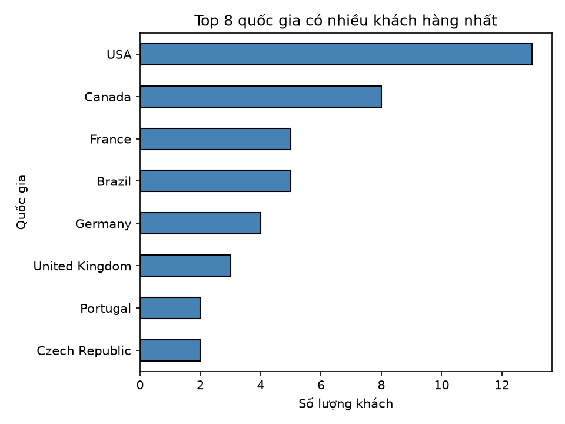
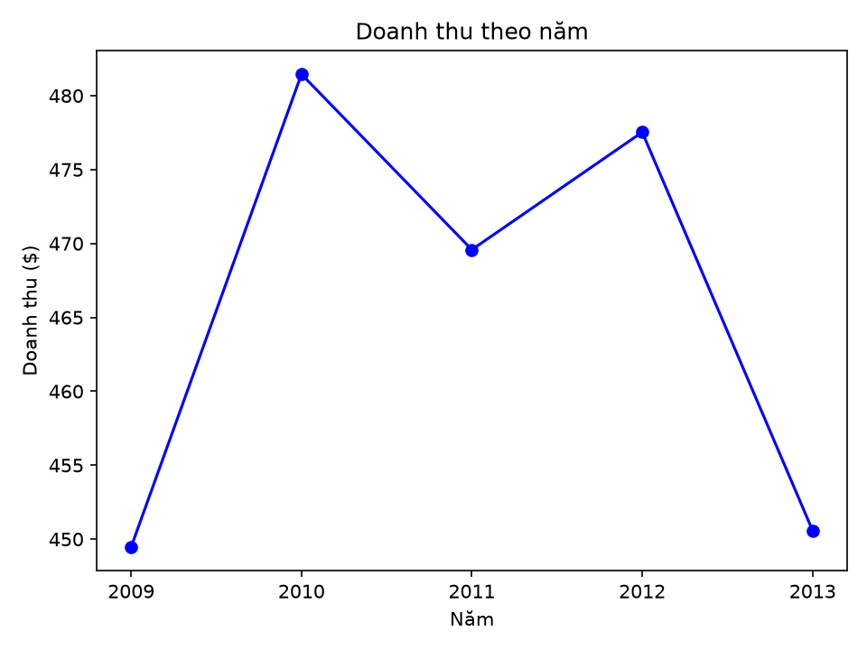

# Phân tích kinh doanh cửa hàng nhạc Chinook

## Mục tiêu
Phân tích dữ liệu bán hàng để trả lời: khách hàng đến từ đâu,
doanh thu biến động thế nào qua các năm.

## Dữ liệu
Database mẫu Chinook (SQLite): 59 khách hàng, 412 hóa đơn, giai đoạn 2009–2013.

## Công cụ
Python, pandas, matplotlib, SQLite

## Kết quả

### 1. Số khách hàng theo quốc gia


**Nhận xét:** Nhóm đông khách nhất là các nước châu Mỹ: Mỹ (13 khách), Canada (8) và Brazil (5), trong khi Bồ Đào Nha và Cộng hòa Séc chỉ có 2 khách mỗi nước. Ý nghĩa kinh doanh: thị trường Bắc Mỹ nên được ưu tiên quảng bá và chăm sóc khách hàng, còn các nước ít khách là nơi có thể thử nghiệm chiến dịch mở rộng với chi phí nhỏ.

### 2. Doanh thu theo năm


**Nhận xét:** Doanh thu dao động quanh mức 450–480 $ mỗi năm, đạt đỉnh năm 2010 (khoảng 481 $), giảm nhẹ năm 2011, hồi lại năm 2012 (khoảng 478 $) rồi giảm khoảng 27 $ xuống còn khoảng 451 $ năm 2013. Ý nghĩa kinh doanh: doanh thu gần như đi ngang, chưa có tăng trưởng; cần tìm nguyên nhân sụt giảm năm 2013 (dữ liệu năm này chỉ đến 22/12 nên có thể chưa đủ năm) và đề ra biện pháp để tăng trưởng.

## Cách chạy
```
pip install -r requirements.txt
python phan_tich.py
```
